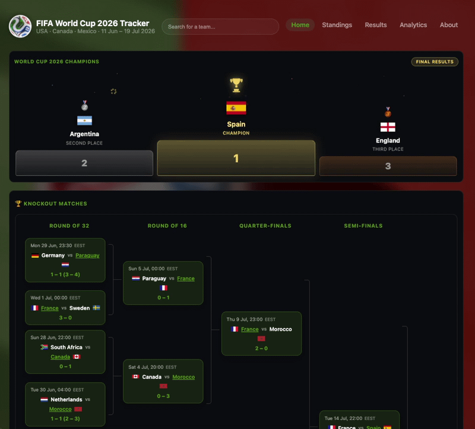

# ⚽ FIFA World Cup 2026 Tracker


A World Cup 2026 tournament dashboard built with React, TypeScript and Vite.


Tournament data is stored as static CSV snapshots in the repository and loaded in the browser. The app uses the [football-data.org](https://www.football-data.org) API for the Fixtures page.


## 🚀 Live Demo


[worldcup2026-tracker-app.vercel.app](https://worldcup2026-tracker-app.vercel.app)


## Preview




## 📚 Table of Contents


- [Live Demo](#-live-demo)
- [Features](#-features)
  - [Home Dashboard](#-home-dashboard)
  - [Analytics](#-analytics)
  - [Pages](#-pages)
  - [Score Handling](#-score-handling)
- [Data Architecture](#️-data-architecture)
  - [Static CSV Data](#static-csv-data)
  - [Data Joining](#data-joining)
  - [Adapter Layer](#adapter-layer)
  - [Data Limitations](#data-limitations)
  - [Planned Analytics Improvement](#planned-analytics-improvement)
- [Tech Stack](#️-tech-stack)
- [Getting Started](#-getting-started)
  - [Prerequisites](#prerequisites)
  - [Installation](#installation)
  - [Environment Variables](#environment-variables)
  - [Run Locally](#run-locally)
  - [Run Tests](#run-tests)
  - [Build for Production](#build-for-production)
- [Project Structure](#-project-structure)
- [Data Sources](#-data-sources)
  - [Static CSV snapshots](#static-csv-snapshots)
  - [football-data.org](#football-dataorg)
- [What I Learned](#-what-i-learned)
- [License](#license)


[↑ Back to contents](#-table-of-contents)


## ✨ Features


### 🏠 Home Dashboard


- 🏆 **Knockout Bracket** — full tournament tree from the Round of 32 to the Final, including the third-place match
- 🥅 **Top Scorers** — top 10 scorer rankings with team crests and names
- ⚽ **Latest Results** — the six most recent completed matches
- 📸 **Image Carousel** — World Cup 2026 venues and highlights


### 📊 Analytics


- 📌 **Tournament Overview** — KPI cards for finished matches, in-play goals, goals per match, penalty shootouts and draws after play
- 📋 **Scoring by Stage** — tournament-stage table with matches, goals, goals per match, penalty shootouts and draws
- ⚔️ **Team Performance** — side-by-side charts for top attacks by goals scored and best defences by fewest goals conceded
- 📈 **Team Statistics** — sortable team table with performance rank, matches played, goals for, goals against, goal difference and goals per match
- ⚽ **Highest-Scoring Matches** — football-themed lollipop ranking of the top 10 completed matches by in-play goals, including match date and tournament stage


### 📄 Pages


- 🏆 **Standings** — group tables for all 12 groups with P, W, D, L, GD and PTS
- 🕐 **Results** — group-stage results by matchday and every knockout stage
- 🗓️ **Fixtures** — fixture list with date, time and venue
- 📊 **Analytics** — tournament, stage, team and high-scoring-match insights
- 🔍 **Team Search** — search all 48 teams and view their tournament results, next match, scorers and status badge
- 🌍 **About** — tournament information, fun facts and external resources


### ⚽ Score handling


- Penalty-shootout kicks are separated from the in-play score.
- For example, a game stored as `4–5` after a `1–1` draw and a shootout is displayed as `1–1 (3–4 pens)`.
- Extra-time goals remain part of the displayed in-play score.
- Analytics ranking and goals-based metrics use **in-play goals only**, excluding penalty-shootout kicks.


[↑ Back to contents](#-table-of-contents)


## 🗄️ Data Architecture


The app uses a static-data architecture for tournament information that does not need to change while a visitor is using the app.


CSV snapshots are stored in `public/data/` and fetched by the frontend through a small reusable data-loading helper. This keeps the app simple, reduces external API usage, and allows the tournament data to remain available without a live database.


| CSV file | Purpose |
|---|---|
| `matches.csv` | Match records, dates, statuses, stages, venues, team IDs and scores |
| `teams.csv` | Team IDs, names, short names, TLAs and crest URLs |
| `scorers.csv` | Player goal totals and team IDs |
| `group-standings.csv` | Group standings, positions, results and goal statistics |
| `tournament-overview.csv` | Tournament-level analytics summary |
| `stage-analytics.csv` | Analytics summary for each tournament stage |
| `team-performance.csv` | All-matches performance statistics for each team |
| `highest-scoring-matches.csv` | Top completed matches ranked by in-play goals |


### Static CSV data


The CSV files are static snapshots exported from the project’s original Supabase database.


They contain the same core data that was previously read through Supabase views:


- Match details
- Team details
- Top scorers
- Group standings
- Tournament overview
- Stage analytics
- Team performance
- Highest-scoring matches


Because the tournament results are fixed historical data, static CSV files are a practical choice for this app.


### Data joining


`matches.csv` contains only `home_team_id` and `away_team_id`. The app joins those IDs with `teams.csv` to display each team’s name, short name, TLA and crest.


```text
matches.csv
  ├── home_team_id ──→ teams.csv
  └── away_team_id ──→ teams.csv
```


`scorers.csv` contains a `team_id` for each scorer. The app joins that ID with `teams.csv` to show the scorer’s team crest and short name.


```text
scorers.csv
  └── team_id ──→ teams.csv
```


This join happens in `src/lib/matches.ts` using a team lookup map.


### Adapter layer


`src/lib/localData.ts` fetches and parses CSV files with [Papa Parse](https://www.papaparse.com/).


`src/lib/matches.ts` loads match, scorer and team data, joins related records, filters and sorts them, then maps the CSV rows into the frontend `Match` type through `toMatch()`.


`src/lib/analytics.ts` loads the analytics CSV snapshots and provides typed functions for the Analytics page.


This preserves the existing `MatchCard`, `formatScore`, and page components while moving the data source from Supabase to static CSV files.


### Data limitations


The free football-data.org plan does not include squad and coach data from `/teams/{id}`. Therefore, the Team page intentionally hides Formation, Coach and Squad sections rather than showing unavailable or empty data.


### Planned analytics improvement


The current `team-performance.csv` combines group-stage and knockout matches.


A future improvement could provide a separate knockout-only performance dataset. This would allow the Analytics page to switch between:


```text
All teams
→ Group-stage and knockout matches combined.


Knockout only
→ Knockout-stage matches only.
```


When available, the selected dataset would update the Team Statistics table, Top Attacks chart, Best Defences chart and calculated performance ranks together.


[↑ Back to contents](#-table-of-contents)


## 🛠️ Tech Stack


| Tool | Purpose |
|---|---|
| React 19 | UI framework |
| TypeScript | Type safety |
| Vite | Build tool and development server |
| React Router v7 | Client-side routing |
| Papa Parse | CSV parsing in the browser |
| Static CSV snapshots | Tournament, team, scorer, standings and analytics data |
| football-data.org API | Live fixture data |
| Vitest | Unit testing |
| Vercel | Deployment and football-data proxy |


[↑ Back to contents](#-table-of-contents)


## 📦 Getting Started


### Prerequisites


- Node.js 18+
- A football-data.org API key for the Fixtures page


### Installation


```bash
git clone https://github.com/mareerray/worldcup2026-tracker.git
cd worldcup2026-tracker
npm install
```


### Environment Variables


Create a `.env` file in the project root:


```env
# Used by the Vite development proxy for football-data.org
FOOTBALL_API_KEY=your_football_data_api_key
```


| Variable | Used by | Notes |
|---|---|---|
| `FOOTBALL_API_KEY` | Local Vite proxy | Sent as `X-Auth-Token` to football-data.org |


> **Note:** Restart the development server after changing `.env`. Never commit `.env` to Git.


For production, set the football-data key in **Vercel → Project → Settings → Environment Variables**.


### Run locally


```bash
npm run dev
```


### Run tests


```bash
npm run test
```


### Build for production


```bash
npm run build
```


[↑ Back to contents](#-table-of-contents)


## 📁 Project Structure


```text
.
├── README.md
├── API_ENDPOINTS.md
├── index.html
├── package.json
├── tsconfig.json
├── tsconfig.app.json
├── tsconfig.node.json
├── vite.config.ts
├── vitest.config.ts
├── vercel.json
├── api/
│   └── football.ts                 # Vercel proxy → football-data.org
├── public/
│   ├── data/
│   │   ├── matches.csv
│   │   ├── teams.csv
│   │   ├── scorers.csv
│   │   ├── group-standings.csv
│   │   ├── tournament-overview.csv
│   │   ├── stage-analytics.csv
│   │   ├── team-performance.csv
│   │   └── highest-scoring-matches.csv
│   └── images/                     # Screenshots and image assets
└── src/
    ├── App.tsx
    ├── main.tsx
    ├── api/
    │   └── footballClient.ts       # Browser helper for /api/football
    ├── components/
    │   ├── ChampionsPodium.tsx
    │   ├── Footer.tsx
    │   ├── GroupTable.tsx
    │   ├── Header.tsx
    │   ├── KnockoutBracket.tsx
    │   ├── MatchCard.tsx
    │   ├── Navbar.tsx
    │   └── SearchBar.tsx
    ├── lib/
    │   ├── analytics.ts            # Analytics CSV data functions
    │   ├── localData.ts            # CSV fetching and parsing helper
    │   └── matches.ts              # Match, scorer and team data functions
    ├── pages/
    │   ├── About.tsx
    │   ├── Analytics.tsx
    │   ├── Fixtures.tsx
    │   ├── Home.tsx
    │   ├── Results.tsx
    │   ├── Standings.tsx
    │   └── TeamPage.tsx
    ├── styles/
    │   ├── Analytics.css
    │   └── ...
    ├── types/
    │   ├── analytics.ts            # Analytics row types
    │   ├── db.ts                   # Data row types
    │   └── index.ts                # Frontend types
    └── utils/
        ├── formatScore.ts
        └── slides.ts
```


[↑ Back to contents](#-table-of-contents)


## 🔑 Data Sources


### Static CSV snapshots


The tournament dashboard, standings, results, team pages and analytics use static CSV snapshots stored in `public/data/`.


- `matches.csv` supplies match lists, knockout bracket data, latest results and team match history.
- `teams.csv` supplies team names, short names, TLAs and crest URLs.
- `scorers.csv` supplies the Home top-scorers list and each team’s scorers.
- `group-standings.csv` supplies the group tables on the Standings page.
- `tournament-overview.csv`, `stage-analytics.csv`, `team-performance.csv` and `highest-scoring-matches.csv` supply the Analytics dashboard.


### football-data.org


The project uses the football-data.org free tier for the Fixtures page.


- **Local development:** Vite proxies `/api/football/*` to football-data.org.
- **Production:** Vercel runs `api/football.ts` as a serverless proxy.
- Free-tier rate limit: approximately 10 calls per minute.


[↑ Back to contents](#-table-of-contents)


## 💡 What I Learned


### How I used AI
AI helped me design the original Supabase tables, views and SQL queries.
After the first version worked, I reviewed the data model and learned how the
football-data.org API data was transformed into database tables and analytics views.


### What I learned by reviewing the data
- **API to database:** The API returns nested JSON. In the database, this became
  flat columns, with teams joined back through views.
- **Data layers:** The analytics pipeline cleaned and normalised data before
  creating summary views.
- **Business rules matter:** Penalty-shootout kicks are not in-play goals.
  Separating them keeps goals-per-match and rankings accurate.
- **Choosing the grain:** `team_performance` has one row per team, while
  `stage_analytics` has one row per stage.
- **Static data architecture:** For a read-only historical tournament dashboard,
  CSV snapshots can reduce database usage and simplify deployment.
- **Data joining:** Match and scorer records store team IDs, while team details
  such as names, short names and crests live in a separate teams dataset.
- **Free-tier limits:** The football-data API has a rate limit and no squad or
  coach data, so the app uses cached tournament snapshots where possible.


### What I would do next
Rebuild the analytics layer in Snowflake as a practice project to learn data
warehousing and compare it with Postgres views.


## License


This project is for educational and portfolio purposes.


---


Built by [Mayuree Reunsati](https://github.com/mareerray) · Mariehamn, Åland · June–November 2026